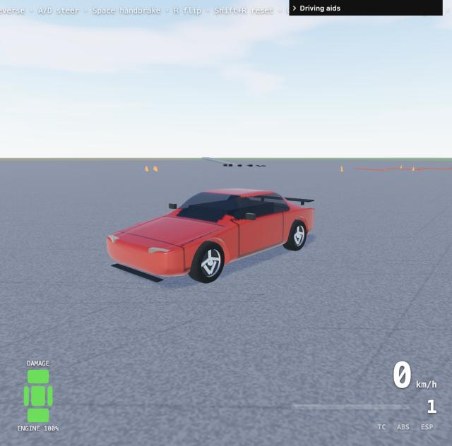
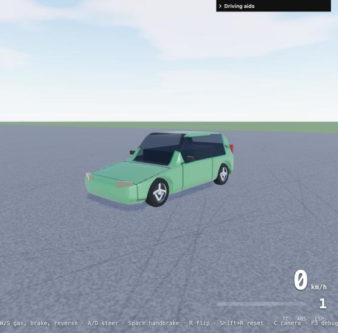
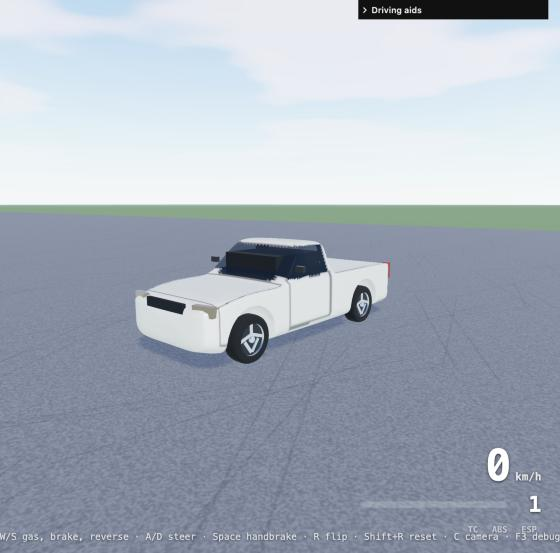
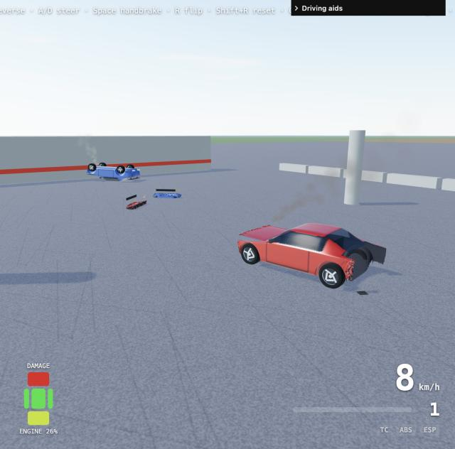
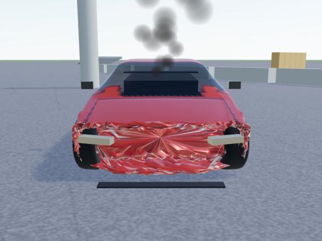

# Open Road

A browser driving sandbox built around **realistic car physics and crash damage**. A flat open test world, obstacles to wreck cars on, three very different cars. Everything runs client-side: Three.js for rendering, Rapier (WASM) for rigid-body physics, and custom code for the tyres, drivetrain and crumple zones.

**Play:** https://daranjacquet.github.io/open-road/

| Sport coupe (RWD) | City hatch (FWD) | Pickup (AWD, heavy) |
| --- | --- | --- |
|  |  |  |

| 100 km/h into a parked car | Crumpled nose, bonnet torn open, engine smoking |
| --- | --- |
|  |  |

## Controls

| Action | Keyboard | Gamepad |
| --- | --- | --- |
| Accelerate | `W` / `Up` | right trigger |
| Brake, then reverse | `S` / `Down` | left trigger |
| Steer | `A` `D` / `Left` `Right` | left stick |
| Handbrake | `Space` | `A` or `X` |
| Flip the car upright | `R` | `Y` |
| Repair and respawn | `Shift+R` | |
| Camera (chase, hood, bumper) | `C` | `B` |
| Switch car | `V` (or the menu) | |
| Reset the parked target cars | `B` | |
| Mute | `M` | |
| Debug overlay | `F3` | |

The gearbox is automatic. Steering lock shrinks with speed and the keyboard input is smoothed. The top-right menu toggles traction control, ABS and ESP.

## Run locally

```bash
npm install
npm run dev        # http://localhost:5173
npm test           # Vitest: tyre model, drivetrain, headless driving and crash simulations
npm run build      # typecheck + production build into dist/
npm run models     # rebuild the car models in Blender (needs `blender` on the PATH)
```

## How it works

```
src/
  core/      fixed-step loop, Rapier setup, input, math
  vehicle/   Vehicle.ts (suspension, tyres, drivetrain, assists), pure helpers, car JSON configs
  damage/    crumple zones, dents, mechanical damage, detachable parts
  render/    scene, camera, procedural car generator, effects, particles
  world/     ground surfaces and test-world props
  game/      GameCar (one complete car) and the car catalogue
  audio/     procedural Web Audio
  ui/        HUD
tests/       unit tests plus headless simulations of driving, crashes and collisions
docs/        screenshots and TUNING.md
public/models/  the exported cars (GLB)
art/         Blender scripts (build_cars.py, specs.py), .blend sources, model conventions
```

### Driving
- Physics steps at a fixed **120 Hz** with render interpolation, independent of frame rate.
- One Rapier rigid body per car. **Suspension is raycast**, written from scratch: spring, asymmetric damper, bump stop, anti-roll bars. Weight transfer is not scripted; it comes out of the forces.
- **Tyre model**: slip ratio and slip angle, a Magic-Formula-style curve, a combined-slip friction ellipse, load sensitivity and surface grip. A one-step stability clamp keeps it well behaved at walking speed.
- **Drivetrain**: engine torque curve, clutch slip at launch, automatic gearbox with anti-hunting, open or limited-slip differential, brake bias, handbrake, drag and downforce.
- Aids: traction control, ABS and a yaw-rate ESP.
- Every car is a JSON file in `src/vehicle/cars/`. See [docs/TUNING.md](docs/TUNING.md) for what each value does.

### Crash damage (hybrid approach)
Full soft-body simulation (BeamNG style) is out of scope for a browser, so damage is hybrid:

1. **Crumple zones.** Each car has a small hard core (the rigid body that Rapier solves) and about 110 to 140 *crush rays* fired outwards through the visible shell. A ray that meets an obstacle pushes back like a plastic spring: force ramps up, saturates, then the zone yields permanently and the ray remembers how deep it was crushed. This gives crash pulses that last tens of milliseconds instead of a one-frame stop, and the per-ray crush depth is the damage field.
2. **Dents.** The ~37k-triangle shell is split into named panels. Each vertex is pushed back along the crush direction of the rays near it, with deterministic crumple noise. The same crash always gives the same dents.
3. **Mechanical damage.** Absorbed energy near the engine bay, a wheel or a body zone becomes power loss, bent wheels (toe pulls the car sideways), softer suspension, less grip and flat tyres.
4. **Detachable parts.** Bonnet, boot lid and doors pop open then tear off as real rigid bodies that tumble and collide. Bumpers, lights, mirrors and glass break by how far they have been dented. Front wheels come off in the hardest hits.
5. **Car vs car.** Cars expose their visible outline only to crush rays (never to the solver), so two cars crumple against each other's real shape.

## Measured performance

Measured on a Mac with a 120 Hz display (dev server, Chromium in the Claude desktop app), scene with the player car and two parked cars plus all props:

| Metric | Result |
| --- | --- |
| Frame rate | 120 fps (display limit) |
| Physics + vehicle step | 0.05 to 0.2 ms per 120 Hz step for 3 cars |
| Draw calls | 127 to 267 depending on the view |
| Triangles | about 350k |
| Production build | 113 kB app + 560 kB three + 4.3 MB rapier (WASM inlined), about 2 MB gzipped |

I have not measured on a modest PC or on mobile. Mobile controls are out of scope.

## Known limits

Honest list of what this is not:

- **Not a soft-body.** Deformation is panel-level and driven by crush rays. There is no internal structure, no chassis bending and no part-to-part load path.
- **Very hard hits bottom out.** At 100 km/h into a wall the crumple depth runs out and the rigid core stops the car abruptly (peak deceleration well above real life).
- **Car vs car energy is approximate.** Each car sees the other's undeformed outline, so absorbed energy is overestimated.
- **Models are Blender-generated but stylised.** `art/build_cars.py` builds each car parametrically (lofted shell, panels, wheels) and exports GLB; the shapes are simple (box lights, no interior detail) and were not hand-sculpted. A TypeScript generator with identical part names stays as a fallback if a GLB fails to load.
- **Handling was tuned with headless simulations** (0-100, braking, skid pad, high-speed stability, steering response), not by a human driver. Expect to adjust the feel; the knobs are in the JSON files.
- **World.** A flat 2 km x 2 km plane with three surfaces and a test area. The prompt asked for a chunk system to be prepared; it is not implemented, the `world/` module is simply isolated.
- Glass shatters in one step (no crack stage). Skid marks only on asphalt. Audio is synthesised and simple.
- Rapier 0.21 ships experimental soft bodies; they were not evaluated.

## License

MIT
