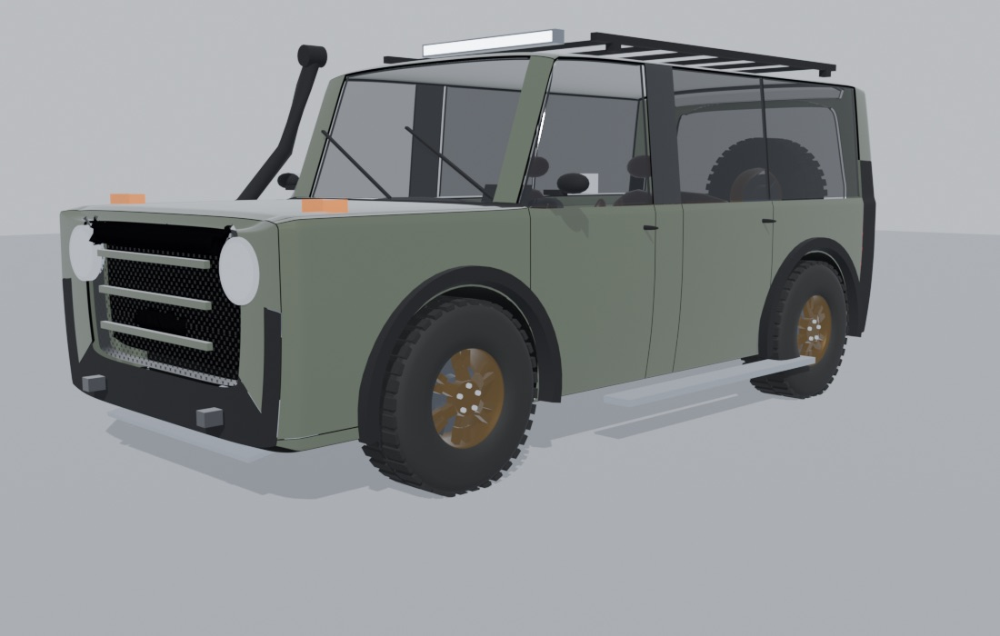
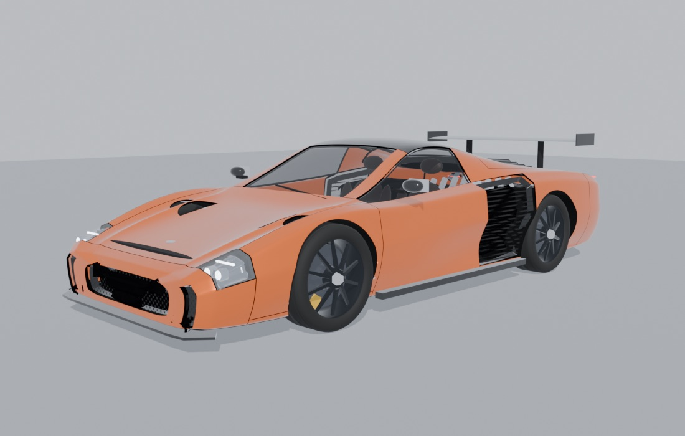
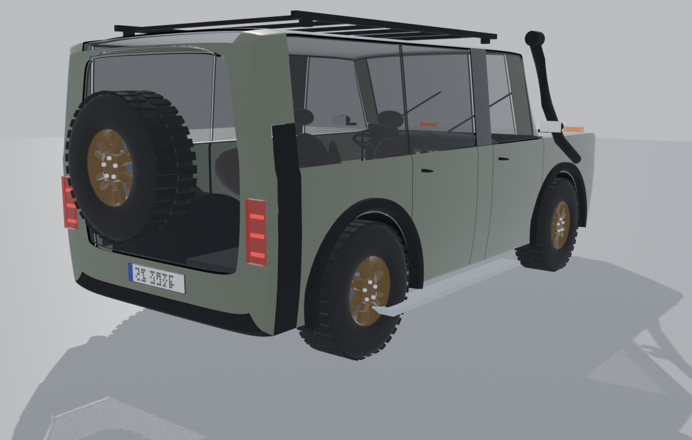
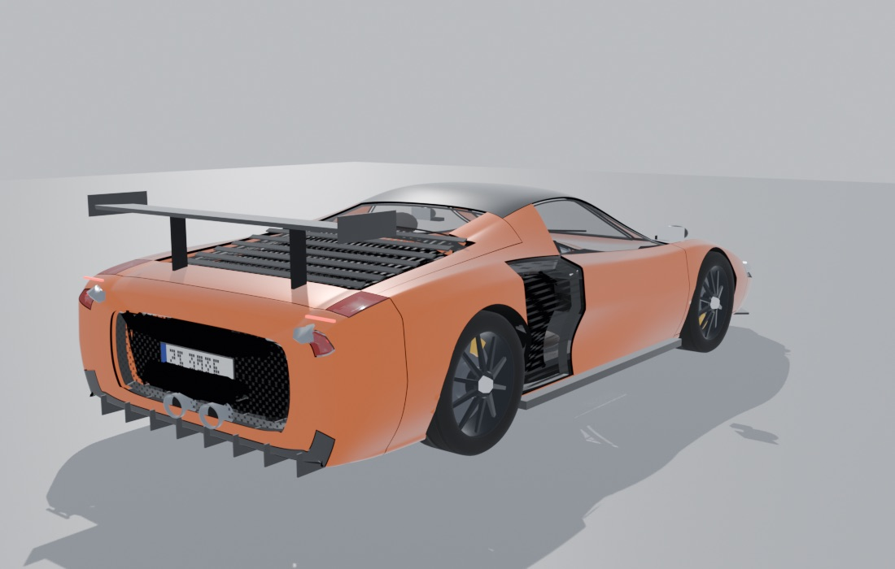
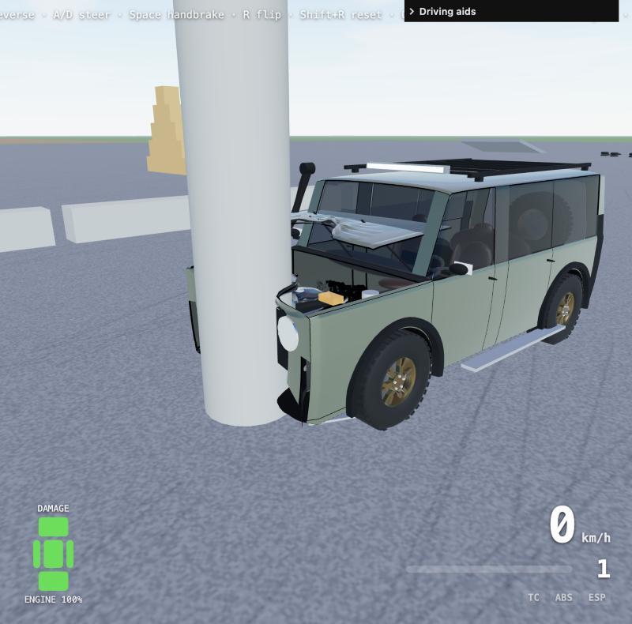

# Open Road

A browser driving sandbox built around **realistic car physics and crash damage**. A 4 km open world with mountains, country roads, a city, two circuits and places to visit, obstacles to wreck cars on, three detailed cars reworked in Blender. Everything runs client-side: Three.js for rendering, Rapier (WASM) for rigid-body physics, and custom code for the tyres, drivetrain, crumple zones and crash deformation.

**Play:** https://daranjacquet.github.io/open-road/

| Sport saloon (rear-biased AWD) | Off-roader (4x4) | Supercar (mid-engine, AWD) |
| --- | --- | --- |
|  |  |  |
|  |  |  |

| 65 km/h into a wall: bonnet folded open, wing crumpled, engine bay exposed | 55 km/h into a pillar: the pillar's shape is pushed into the nose |
| --- | --- |
|  |  |
| **Torn-off bumper with scraped paint** | **Side impact: doors pushed in and sprung, windows cracked** |
|  |  |

## Controls

| Action | Keyboard | Gamepad |
| --- | --- | --- |
| Accelerate | `W` / `Up` | right trigger |
| Brake, then reverse | `S` / `Down` | left trigger |
| Steer | `A` `D` / `Left` `Right` | left stick |
| Handbrake (also presses the clutch) | `Space` | `A` or `X` |
| Shift up / down (manual gearbox) | `E` / `Q` | `RB` / `LB` |
| Garage (setups and settings) | `G` | |
| Flip the car upright | `R` | `Y` |
| Repair where you are | `F` (or the on-screen button) | |
| Repair and respawn | `Shift+R` | |
| Camera (chase, hood, bumper) | `C` | `B` |
| Orbit the camera around the car / zoom | hold right mouse button and move / wheel | |
| Teleport to the next place | `T` (or the garage menu) | |
| Map (click a place to go there) | `N` | |
| Switch car | `V` (or the menu) | |
| Reset the parked target cars | `B` | |
| Mute | `M` | |
| Debug overlay | `F3` | |

The gearbox is automatic by default (manual in the garage). The steering is assisted: holding a direction asks the front tyres for their best grip, whatever the speed, and the wheels countersteer by themselves when the rear slides. You can turn every aid down in the garage.

### Garage

The top-right panel (`G`) changes the car live and saves the setup per car:

- **Setups**: Stock, **Drift** (RWD, welded diff, 58 degrees of lock, front camber, wider front track, soft rear grip, big handbrake, no stability aid) and **Track** (stiffer and lower, wider tyres, more grip and downforce).
- **Steering**: lock, steering assist, stability assist, slide control, steering speed.
- **Engine**: power, torque, rev limit. **Driveline**: FWD, RWD or AWD, AWD split, diff lock, final drive, auto or manual gearbox.
- **Suspension**: ride height, springs, dampers, anti-roll bars. **Wheels and tyres**: track width, camber, tyre width, grip, rear grip balance, grip while sliding.
- **Brakes**: power, bias, handbrake. **Chassis**: mass, weight distribution, downforce. **Driving aids**: TC, ABS, ESP.

### The map

A 4 km x 4 km world with hills, a mountain range and a ring of peaks at the edge. The minimap (bottom left) turns with the car; `N` opens the whole map, where clicking a place drives you there. Driving off the edge or into the lake puts the car back on the last spot where it stood on dry ground, repaired.

- **Test area** (start): crash wall, barriers, ramps, props, a long straight that leads to the mountain pass.
- **City**: a grid of avenues and streets with raised pavements, a couple of hundred buildings that get taller towards downtown, shops on the ground floors, street trees, a central square with a fountain, a 170 m landmark tower, a **multi-storey car park you can drive up**, parks and car parks, lane markings, zebra crossings and stop lines, traffic lights that cycle, stop and speed-limit signs, and street lamps. Lamps and signs fall over when you hit them.
- **Country roads** (13 km): a **mountain pass** with hairpins and a viaduct up to a summit viewpoint at about 80 m, a lake road, a southern road past the farm and the airfield, a forest road, gravel tracks; guard rails where the ground drops away, direction signs at the junctions.
- **Places**: a **lake village** with a church and a harbour jetty you can drive onto, a petrol station, an **airfield** with a 1.3 km runway (top-speed runs), hangars and a tower, a **farm** among fields, a **quarry** with jumps and dirt mounds, the **summit viewpoint**.
- **Forests** of about 50,000 trees (you can hit them), thicker on the hills and mountains.
- **Grand Prix circuit**: 2.9 km, 14 m wide, long main straight, hairpin, esses, kerbs, armco and a start gantry.
- **Drift circuit**: 2 km, 16 m wide, tight and twisty, red and white block walls.
- **Lap timer** on both circuits: a lap counts only if you went through every sector; best laps are saved per car and circuit.

## Run locally

```bash
npm install
npm run dev        # http://localhost:5173
npm test           # Vitest: tyre model, drivetrain, headless driving and crash simulations
npm run build      # typecheck + production build into dist/
npm run models     # rebuild the cars in Blender and compress them into public/models (needs `blender`)
```

## How it works

```
src/
  main.ts    boot only: builds the systems below and hands them to Game
  core/      fixed-step loop, Rapier setup (with the surface lookup), input, math
  vehicle/   Vehicle.ts (suspension, tyres, drivetrain, assists), SteeringController, tuning, car JSON configs
  damage/    crumple zones, dents, mechanical damage, detachable parts
  render/    scene, camera, adaptive resolution, GLB car loader and paint/glass shaders, effects, smoke
  world/     world plan (layout.ts), terrain generation (worldgen.ts, in a worker), terrain chunks,
             roads, places, city, circuits, trees, lake, minimap picture, surface raster
  game/      Game (frame loop, cars, actions), GameCar (one complete car), RaceSystem and lap timer, catalogue
  audio/     procedural Web Audio
  ui/        HUD and garage panel
tests/       unit tests plus headless simulations of driving, handling, crashes, collisions, map
docs/        AUDIT.md (models, performance, architecture), TUNING.md, screenshots
public/models/  the exported cars (GLB)
art/         Blender: import pipeline for third-party car models (import_car.py, inspect_model.py,
             lib/importer.py, imports/<id>.json), model sources and .blend files
scripts/     optimize-models.mjs (meshopt compression of the Blender exports)
```

Layering, enforced by ESLint (`npm run lint`, `eslint.config.js`): `core` <- `vehicle`, `damage` (simulation, no rendering) <- `render`, `world`, `audio` <- `game` <- `ui` <- `main`. Only type-only imports may point up (damage names render's mesh types, game names the HUD and garage types). `npm run check` runs lint, types and tests; CI runs lint, tests and the build before deploying.

**Performance**: the render resolution adapts to the frame rate (pixel ratio 0.6 to 1.5; *Garage > Graphics* pins it), the physics loop does not allocate, and a crash's dent normals are recomputed under a per-frame budget. See [docs/AUDIT.md](docs/AUDIT.md) for measurements.

### Driving
- Physics steps at a fixed **120 Hz** with render interpolation, independent of frame rate.
- One Rapier rigid body per car. **Suspension is raycast**, written from scratch: spring, asymmetric damper, bump stop, anti-roll bars. Weight transfer is not scripted; it comes out of the forces.
- **Tyre model**: slip ratio and slip angle, a Magic-Formula-style curve, a combined-slip friction ellipse, load sensitivity and surface grip. A one-step stability clamp keeps it well behaved at walking speed.
- **Drivetrain**: engine torque curve, clutch slip at launch, automatic gearbox (shifts on road speed, holds the gear in wheelspin) or manual, open or limited-slip differential, brake bias, handbrake with clutch, drag and downforce.
- **Arcade layer, each on a slider**: steering assist (the input asks for front slip angle relative to where the front axle is going, so full lock never ploughs and the wheels countersteer in a slide), stability assist (unwinds the steering when the rear slides) and slide control (a damper on how fast the slip angle changes, not on how far it can go, so slides settle instead of snapping).
- Aids: traction control, ABS and a yaw-rate ESP.
- Every car is a JSON file in `src/vehicle/cars/`. See [docs/TUNING.md](docs/TUNING.md) for what each value does.

### Cars and models
The three cars are hand-made models from Sketchfab (CC BY 4.0, see [CREDITS.md](CREDITS.md)), reworked for crashes by a Blender pipeline (`art/import_car.py`, one mapping per car in `art/imports/`):

- **Rally saloon** (Evo-style 90s four-door, wing and bonnet scoop): Thunderbolt '96 by Daniel Zhabotinsky, 19k triangles.
- **Off-roader**: Bokaroo '67 by Daniel Zhabotinsky, 28k triangles.
- **Supercar**: V12 Goblin by ollitei, 66k triangles.
- The pipeline orients and scales each model, removes badges, cuts it into the crash parts (doors, bonnet, boot or engine cover, bumpers, every glass pane, lights, mirrors) with their hinges, rebuilds the wheels around their hubs, keeps the original textures (resized, WebP) under the material names the game reacts to, and places the chassis origin where the suspension expects it.
- `scripts/fit-car-config.mjs` then fits the physics geometry to the model (wheel positions and size, the hard core, the outline and the crumple-ray grids), keeping every handling value.
- 30 to 43 meshes per car (the old procedural cars had about 100) and 1.4 to 1.5 MB per car with textures.

### Crash damage
Full soft-body simulation (BeamNG style) is too heavy for a browser, so damage is split in two:

1. **Crumple zones (physics).** Each car has a small hard core (the rigid body Rapier solves) and about 100 to 140 *crush rays* fired outwards through the visible shell. A ray that meets an obstacle pushes back like a plastic spring: the force ramps up, saturates, then the zone yields for good. Crash pulses last tens of milliseconds instead of one frame, and the absorbed energy drives the mechanical damage.
2. **Deformation field (visuals).** A 10 cm lattice covers the car. Whenever the crumple zones yield, lattice nodes that ended up inside the obstacle are pushed back out to its surface along the crush direction, so the car takes the **imprint of what it hit**: a pillar leaves a V, a wall flattens the nose, another car leaves its shape (capped to what the crumple zone really took). A screened Laplace relaxation drags the surrounding metal along, and the passenger cell stays pinned.
3. **Crumpling.** Where the field squeezes a panel in its own plane, the sheet has to fold because its length is conserved. Each vertex gets a wrinkle whose amplitude follows from the local compression, which gives accordion bonnets and rippled wings instead of a shrunken car.
4. **Paint and glass.** Badly dented metal loses its paint in patches (scuff shader), and windows crack in a spider web around the deepest point before they shatter.
5. **Mechanical damage.** Energy absorbed near the engine bay, a wheel or a body zone becomes power loss, bent wheels (toe pulls the car sideways), softer suspension, less grip and flat tyres.
6. **Parts.** The bonnet, boot and doors spring open, then tear off as rigid bodies that keep their dents. Bumpers, lights, mirrors and glass break by how far they have been dented. Front wheels come off in the hardest hits.

Everything is deterministic: the same crash gives the same damage.

## Measured performance

Measured on a Mac with a 120 Hz display (production build, Chromium in the Claude desktop app, frames driven at 60 Hz with a GPU sync), with the player car, two parked cars and all props:

| Metric | Result |
| --- | --- |
| Frame time while driving | 6.5 to 8 ms (GPU), 2.7 to 3.5 ms of CPU, depending on the place |
| Physics + vehicles | 0.05 to 0.3 ms per 120 Hz step for 3 cars |
| Crash frame | 10 to 13 ms for the worst frame of a warm 70 km/h wall crash |
| Draw calls | 250 to 450 (city and test area are the busiest) |
| Triangles | 450k to 650k |
| Loading | about 0.9 s from scripts to the first frame (the world is built in a worker meanwhile) |
| Download | 215 kB app + 107 kB world worker + 670 kB three + 4.3 MB Rapier + the cars on screen (meshopt) |

I have not measured on a modest PC; the render resolution adapts to the frame rate. See [docs/AUDIT.md](docs/AUDIT.md) for the details.

## Known limits

- **Not a soft-body.** The car does not bend as a structure: the deformation field shapes the panels, the rigid body keeps its mass and inertia, and the passenger cell never deforms.
- **Very hard hits bottom out.** At 100 km/h into a wall the crumple depth runs out and the rigid core stops the car abruptly (peak deceleration well above real life).
- **Car vs car is approximate.** Each car sees the other's undeformed outline box; dents are capped by its own crush, so impacts look plausible but not exact.
- **Cars are reworked third-party models** (see `CREDITS.md`): crash parts are cut out of a single body by boxes, so panel edges follow straight cuts, not the real shut lines.
- **Handling was tuned with headless simulations**, not by a human driver: full-lock corners from 60 to 180 km/h, slaloms, handbrake flicks and a keyboard-style drifter that only presses keys fully (`tests/handling.test.ts`).
- **World.** No traffic and no pedestrians. The whole world is built at load (terrain in a worker, about 1 s in all); no streaming. Trees and the terrain far away use simpler models.
- Skid marks only on asphalt. Audio is synthesised and simple.

## License

Code: MIT. Car models: CC BY 4.0 by their authors, see [CREDITS.md](CREDITS.md).
