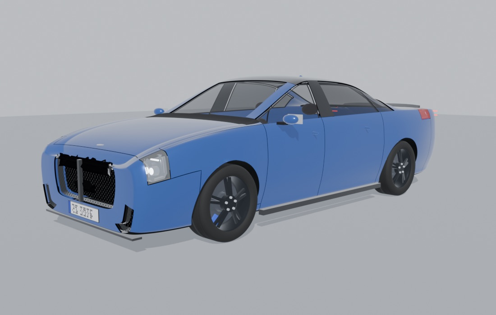
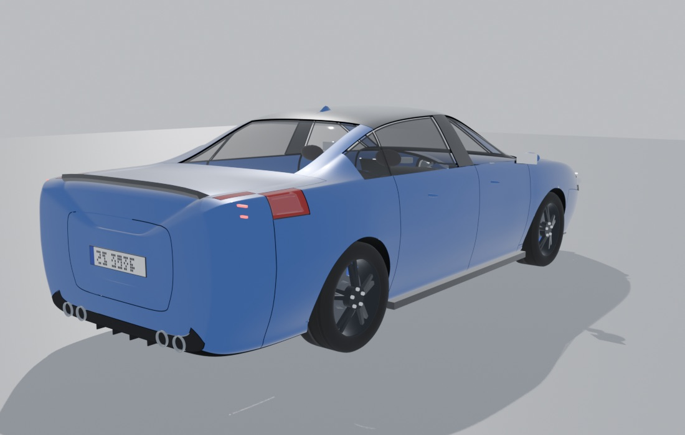
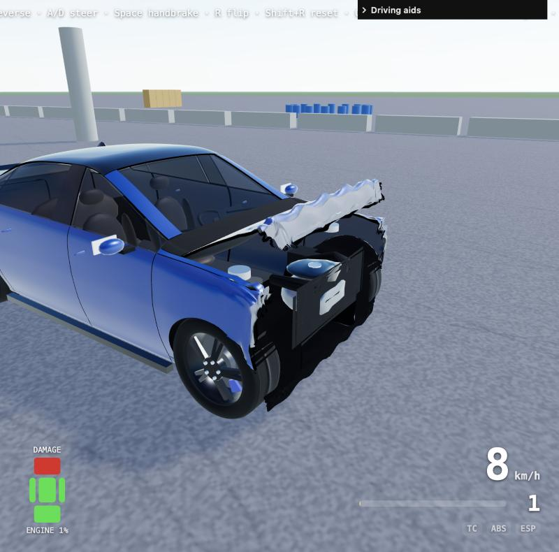
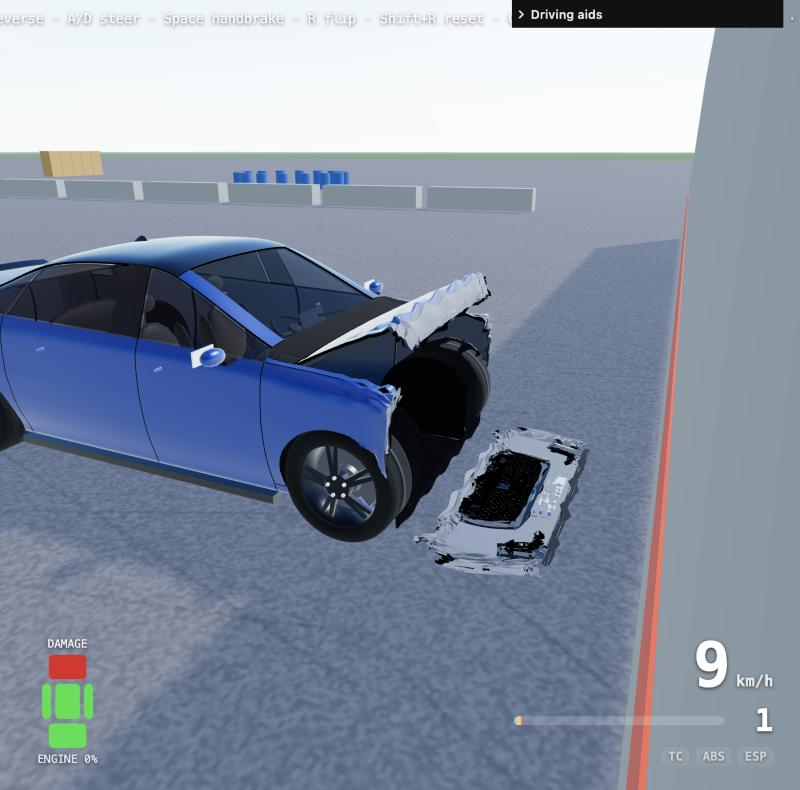
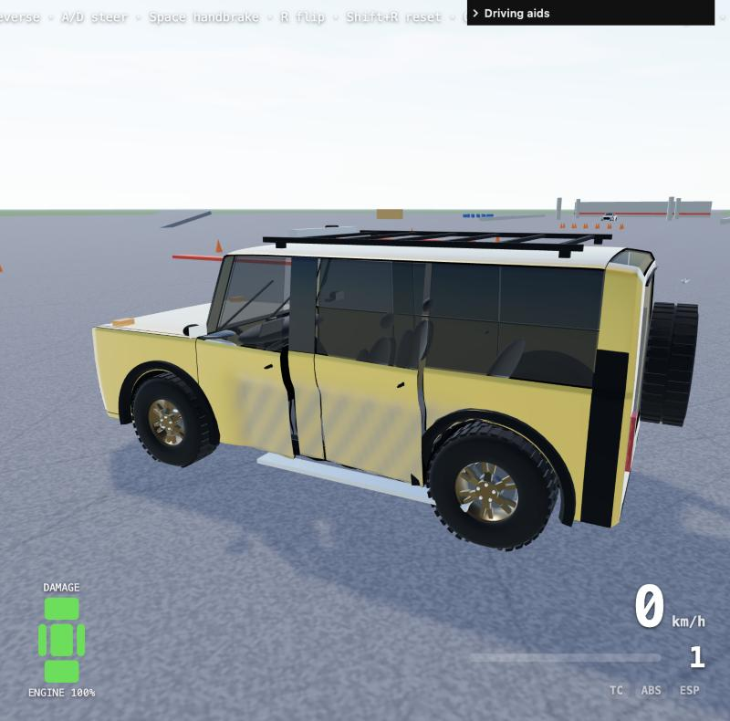
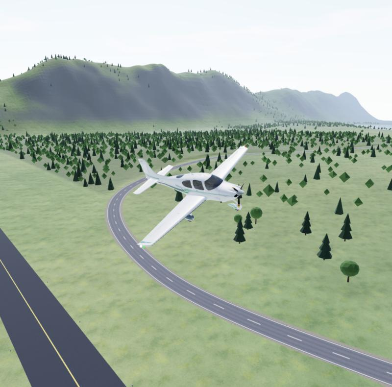
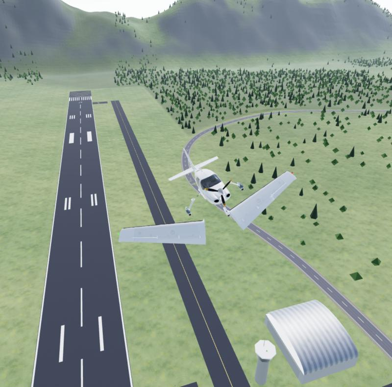

# Open Road

A browser driving sandbox built around **realistic car physics and crash damage**. A 4 km open world with mountains, country roads, a city, two circuits and places to visit, obstacles to wreck cars on, three detailed cars reworked in Blender, and a **Cirrus SR22 light aircraft** to fly from the airfield, with a flight model built surface by surface and wings, tail and gear that come off. Everything runs client-side: Three.js for rendering, Rapier (WASM) for rigid-body physics, and custom code for the tyres, drivetrain, aerodynamics, crumple zones and crash deformation.

**Play:** https://daranjacquet.github.io/open-road/

| Sport saloon (rear-biased AWD) | Off-roader (4x4) | Supercar (mid-engine, AWD) |
| --- | --- | --- |
|  |  |  |
|  |  |  |

| 65 km/h into a wall: bonnet folded open, wing crumpled, engine bay exposed | 55 km/h into a pillar: the pillar's shape is pushed into the nose |
| --- | --- |
|  |  |
| **Torn-off bumper, bonnet sprung open** | **Side impact: doors pushed in and sprung, windows cracked** |
|  |  |
| **The SR22 climbing out of the airfield** | **Pulled hard at 210 kt: both wings fold off** |
|  |  |

## Controls

| Action | Keyboard | Gamepad |
| --- | --- | --- |
| Accelerate | `W` / `Up` | right trigger |
| Brake, then reverse | `S` / `Down` | left trigger |
| Steer | `A` `D` / `Left` `Right` | left stick |
| Handbrake (also presses the clutch) | `Space` | `A` or `X` |
| Shift up / down (manual gearbox) | `E` / `Q` | `RB` / `LB` |
| Garage (setups and settings) | `G` | |
| Turn the car in the air (pitch with W/S, roll with A/D) | `W` `S` `A` `D` while airborne | |
| Flip the car upright | `R` | `Y` |
| Repair where you are | `F` (or the on-screen button) | |
| Repair and respawn | `Shift+R` | |
| Camera (chase, hood, bumper) | `C` | `B` |
| Orbit the camera around the car / zoom | hold right mouse button and move / wheel | |
| Teleport to the next place | `T` (or the garage menu) | |
| Map (click a place to go there) | `N` | |
| Next vehicle: the cars, then the SR22 (keeps your position, attitude, speed and spin, upside down included) | `V` (or the menu) | |
| Reset the parked target cars | `B` | |
| Mute | `M` | |
| Debug overlay | `F3` | |

| Get into the aircraft (car stopped next to it) | `Enter` | `Start` |

The gearbox is automatic by default (manual in the garage). The steering is assisted: holding a direction asks the front tyres for their best grip, whatever the speed, and the wheels countersteer by themselves when the rear slides. You can turn every aid down in the garage.

### Flying the SR22

The aircraft waits at the start of **runway 27** at the airfield (or teleport to *Fly the SR22*). Drive up to it and press `Enter`; press `Enter` again, stopped on the ground, to get out (your car waits beyond the left wing tip).

| Action | Keyboard | Gamepad |
| --- | --- | --- |
| Stick back (nose up) / forward (nose down) | `S` `Down` / `W` `Up` | left stick |
| Roll left / right (ailerons; steers the nose wheel on the ground) | `A` `D` / `Left` `Right` | left stick |
| Rudder left / right | `Q` / `E` | `LB` / `RB` |
| Throttle up / down (the lever stays where you leave it) | hold `Shift` / `Ctrl` | right / left trigger |
| Flaps 0, 50, 100 % (`Shift+X` back a notch) | `X` | `X` |
| Wheel brakes | `Space` | `A` |
| View: chase or cockpit | `C` | `B` |
| Stall protection on / off | `P` | |
| Boosted engine (power x4, default) / stock engine | `B` | |
| Arcade flight (default) / simulation | `H` | |
| Back to runway 27, repaired | `R` | `Y` |
| Repair in place | `F` | |

A normal flight: flaps 50 % (`X`), full power (`Shift`), keep straight with `Q`/`E`, ease the stick back at about 65 kt and let go once the nose is 8 to 10 degrees up; it lifts off after about 280 m and climbs at 1,000 to 1,200 ft/min. Flaps up above 300 ft. It cruises at about 160 kt at 75 % power. To land, come back to **runway 09** from the west (the hills east of the airfield rise to 180 m): power to about 20 to 30 %, full flaps, 70 to 75 kt on a 3-degree slope (the PAPI left of the runway shows two white and two red lights), power off and flare over the threshold. It stops in about 200 m with the brakes.

**Arcade flight** is on by default (`H` switches to the simulation): the stick asks for a rotation rate and the aircraft turns at it, without stalling and without trim to manage; let go of the stick and it keeps its attitude, let go of the roll keys and the wings come back level; and flying never breaks the aircraft, however fast (only crashes do; the wings' load limit applies in the simulation). The rest of this section describes the simulation.

Aids: **auto-trim** holds the attitude whenever you let go of the stick, **coordinated rudder** keeps the slip ball centred in the air, and with the keyboard the **stall protection** (`P`) stops the elevator just short of the stall (a gamepad flies without it). The wings can still be pulled past their load limit at high speed.

The instruments (bottom right): attitude indicator, airspeed in km/h, altitude in feet, vertical speed, heading, load factor, rpm, throttle, flaps, and a stall warning that flashes and sounds a horn about 8 kt before the stall. Bottom left, a top view of the aircraft shows each part that has come off.

### Garage

The sliders keep their ranges, but any value typed in a box is taken as it is, past the range too (a positive quantity such as mass or power is held at a tenth of its slider's minimum, so it never reaches zero). The top-right panel (`G`) picks the vehicle (the three cars and the SR22, taking over where you are at your speed) and changes the car live, saving the setup per car:

- **Setups**: Stock, **Drift** (RWD, welded diff, 58 degrees of lock, front camber, wider front track, soft rear grip, big handbrake, no stability aid), **Rally** (four-wheel drive with a rear bias, a mostly locked diff, soft and tall suspension, gravel tyres that keep their grip when sliding, full drift assist: slides easily on dirt or asphalt and still corners at about 1.4 g) and **Track** (stiffer and lower, wider tyres, more grip and downforce).
- **Steering**: lock, steering assist, stability assist, slide control, steering speed, **arcade grip**, **drift assist**.
- **Engine**: power, torque, rev limit. **Driveline**: FWD, RWD or AWD, AWD split, diff lock, final drive, auto or manual gearbox.
- **Suspension**: ride height, springs, dampers, anti-roll bars. **Wheels and tyres**: track width, camber, tyre width, grip, rear grip balance, grip while sliding, dirt and grass grip.
- **Engine**: raising the power also lengthens the final drive (until you set it yourself), so a stronger engine reaches a higher top speed instead of hitting the rev limiter in top gear.
- **Brakes**: power, bias, handbrake. **Chassis**: mass, weight distribution, downforce. **Driving aids**: TC, ABS, ESP.

### The map

A 4 km x 4 km world with hills, a mountain range and a ring of peaks at the edge. The minimap (bottom left) turns with the car; `N` opens the whole map, where clicking a place drives you there. Driving off the edge or into the lake puts the car back on the last spot where it stood on dry ground, repaired.

- **Test area** (start): crash wall, barriers, ramps, props, a long straight that leads to the mountain pass.
- **City**: a grid of avenues and streets with raised pavements, a couple of hundred buildings that get taller towards downtown, shops on the ground floors, street trees, a central square with a fountain, the **twin towers of the World Trade Center** (417 m, the North Tower with its antenna) just south of it, a 170 m landmark tower, a **multi-storey car park you can drive up**, parks and car parks, lane markings, zebra crossings and stop lines, traffic lights that cycle, stop and speed-limit signs, and street lamps. Lamps and signs fall over when you hit them.
- **Country roads** (13 km): a **mountain pass** with hairpins and a viaduct up to a summit viewpoint at about 80 m, a lake road, a southern road past the farm and the airfield, a forest road, gravel tracks; guard rails where the ground drops away, direction signs at the junctions.
- **Rally stage** (2.6 km): from the city's north edge to the loop under the mountains, through wooded hills (70 m of climbing), asphalt and gravel in turn, timed between a START and a FINISH gantry. **Forest trail** (1.5 km): a narrow gravel track up and down the steep hills along the west edge (grades up to 20 %), for the 4x4 and rally setups, timed too. Both are on the map and in the teleports; best times are kept per car.
- **Places**: a **lake village** with a church and a harbour jetty you can drive onto, a petrol station, an **airfield** (below), a **farm** among fields, a **quarry** with jumps and dirt mounds, the **summit viewpoint**.
- **Airfield**: runway 09/27, 1,320 m by 45 m, marked like a real one (threshold stripes, runway numbers, touchdown zone, aiming points, centre line, edges), blast pads with yellow chevrons, edge, threshold, runway-end and approach lights, a **PAPI** at each end whose four lights really turn white or red with your angle above the approach, windsocks, a parallel taxiway with its centre line, blue edge lights, holding points and red runway signs, an apron with parking stands and two parked SR22s, hangars and a control tower. The approaches are clear of trees. Cars can use the runway for top-speed runs.
- **Skyscrapers that come down**: the twin towers, the landmark tower and the high-rises of 60 m and more. Their ground floor is a ring of wall sections around a core: crash into one hard enough and it caves in (the car's kinetic energy against the section's strength, the rest carrying to its neighbours): from about 60 km/h a section goes, and around 100 km/h a 70 m high-rise comes down in one hit (the twin towers take a couple of 200 km/h hits). Lose a whole side, or almost a third of the ring, and the tower falls: it breaks into pieces about 8 to 20 m across (storey slices cut into wedges around the axis, each split again halfway out, up to about 320 per tower) that lean over towards the side that gave way and come down through the city in a cloud of dust, crushing whatever is under them. The pieces of a collapse are drawn together in one batched mesh per material (a few draw calls for hundreds of pieces), and rubble that has settled turns static, so a fallen tower costs almost nothing after about ten seconds. **Fly the SR22 into one** (from about 65 kt, anywhere from 5 m up) and it breaks where it was hit: the top falls over the way the aircraft was flying, and a couple of seconds later the stump and the ground floor come down too. The aircraft does not stop dead: it flies on through the tower with the energy breaking it did not take, and through the falling blocks (except on the twin towers, `passThrough: false`). Behind the ground-floor wall is the concrete core, so a car that knocks a section in stops there instead of driving on under the tower. Each tower has a rule saying which vehicles can break it (`breakers` in `src/world/skyscrapers.ts`): all of them by default, cars only for the twin towers (the game does not stage the September 11 attacks). Teleporting anywhere puts every tower back up. The other buildings are solid.
- **Forests** of about 50,000 trees (you can hit them), thicker on the hills and mountains.
- **Ground**: grass, forest floor, fields, dirt, sand, rock and snow blended over the terrain. Close up, grass shows tufts and blades and dirt shows grain and pebbles, with relief that catches the light; from the driving seat, coarser tufts and patches of drier or lusher grass and damp earth. Dirt tracks are brown earth with two packed wheel tracks, a looser crown and grass coming through at the edges. All of it comes from one procedural texture set made at load (`src/world/groundtex.ts`).
- **Grand Prix circuit**: 2.9 km, 14 m wide, long main straight, hairpin, esses, kerbs, armco and a start gantry.
- **Drift circuit**: 2 km, 16 m wide, tight and twisty, red and white block walls.
- **Lap timer** on both circuits: a lap counts only if you went through every sector; best laps are saved per car and circuit. Stages are timed start to finish through five checkpoints (cutting a corner is fine, a shortcut voids the run).

## Run locally

```bash
npm install
npm run dev        # http://localhost:5173
npm test           # Vitest: tyre model, drivetrain, headless driving, crash and flight simulations
npm run build      # typecheck + production build into dist/
npm run models     # rebuild the cars and the aircraft in Blender and compress them into public/models (needs `blender`)
```

## How it works

```
src/
  main.ts    boot only: builds the systems below and hands them to Game
  core/      fixed-step loop, Rapier setup (with the surface lookup), input, math
  vehicle/   Vehicle.ts (suspension, tyres, drivetrain, assists), SteeringController, tuning, car JSON configs;
             aircraft/ (Aircraft.ts: surfaces, propeller, gear, structure; sr22.json)
  damage/    crumple zones, dents, mechanical damage, detachable parts
  render/    scene, camera (car and aircraft views), adaptive resolution, GLB car and aircraft loaders,
             paint/glass shaders, effects, smoke
  world/     world plan (layout.ts), terrain generation (worldgen.ts, in a worker), terrain chunks,
             roads, places, airfield, city, circuits, trees, lake, minimap picture, surface raster
  game/      Game (frame loop, cars, the aircraft, actions), GameCar (one complete car), GameAircraft
             (the aircraft's model, moving controls, debris, smoke), RaceSystem and lap timer, catalogue
  audio/     procedural Web Audio
  ui/        HUD, flight instruments and garage panel
tests/       unit tests plus headless simulations of driving, handling, crashes, collisions, map
docs/        AUDIT.md (models, performance, architecture), TUNING.md, screenshots
public/models/  the exported cars and aircraft (GLB)
art/         Blender: import pipeline for third-party car models (import_car.py, inspect_model.py,
             lib/importer.py, imports/<id>.json) and for the aircraft (import_plane.py, explore_plane.py),
             model sources and .blend files
scripts/     optimize-models.mjs (meshopt compression of the Blender exports)
```

Layering, enforced by ESLint (`npm run lint`, `eslint.config.js`): `core` <- `vehicle`, `damage` (simulation, no rendering) <- `render`, `world`, `audio` <- `game` <- `ui` <- `main`. Only type-only imports may point up (damage names render's mesh types, game names the HUD and garage types). `npm run check` runs lint, types and tests; CI runs lint, tests and the build before deploying.

**Performance**: the render resolution adapts to the frame rate (pixel ratio 0.6 to 1.5; *Garage > Graphics* pins it), the physics loop does not allocate, and a crash's dent normals are recomputed under a per-frame budget. See [docs/AUDIT.md](docs/AUDIT.md) for measurements.

### Driving
- Physics steps at a fixed **120 Hz** with render interpolation, independent of frame rate.
- One Rapier rigid body per car. **Suspension is raycast**, written from scratch: spring, asymmetric damper, bump stop, anti-roll bars. Weight transfer is not scripted; it comes out of the forces.
- **Tyre model**: slip ratio and slip angle, a Magic-Formula-style curve, a combined-slip friction ellipse, load sensitivity and surface grip. A one-step stability clamp keeps it well behaved at walking speed.
- **Drivetrain**: engine torque curve, clutch slip at launch, automatic gearbox (shifts on road speed, holds the gear in wheelspin) or manual, open or limited-slip differential, brake bias, handbrake with clutch, drag and downforce.
- **Arcade layer, each on a slider**: steering assist (the input asks for front slip angle relative to where the front axle is going, so full lock never ploughs and the wheels countersteer in a slide), stability assist (unwinds the steering when the rear slides) and slide control (a damper on how fast the slip angle changes, not on how far it can go, so slides settle instead of snapping).
- **Arcade grip** (garage slider, 70 % by default): a sideways force at the centre of mass worth a share of what the tyres give (15 % at low speed, up to 57 % above 140 km/h), so the car turns in at speed instead of ploughing without changing its balance (the saloon goes from 1.0 to 1.5 g at 150 km/h); a little more front grip below 100 km/h; dirt and grass keep their grip once sliding.
- **Drift assist** (garage slider; 70 % on the saloon and the 4x4, 15 % on the supercar, which stays planted like a race car): with the throttle held in a slide, the aids let the wheels spin, four-wheel drive sends its torque to the rear, and a share of the engine's drive pushes the car along its heading while its path bends towards where it points. More power means more push, so the throttle holds and steers the drift.
- Aids: traction control, ABS and a yaw-rate ESP. In a slide held on the throttle (5 to 35 degrees) they let the wheels spin and step in only gently; past that they act fully.
- Every car is a JSON file in `src/vehicle/cars/`. See [docs/TUNING.md](docs/TUNING.md) for what each value does.

### Cars and models
The three cars are hand-made models from Sketchfab (CC BY 4.0, see [CREDITS.md](CREDITS.md)), reworked for crashes by a Blender pipeline (`art/import_car.py`, one mapping per car in `art/imports/`):

- **Rally saloon** (Evo-style 90s four-door, wing and bonnet scoop): Thunderbolt '96 by Daniel Zhabotinsky, 19k triangles.
- **Off-roader**: Bokaroo '67 by Daniel Zhabotinsky, 28k triangles.
- **Supercar**: V12 Goblin by ollitei, 66k triangles.
- The pipeline orients and scales each model, removes badges, cuts it into the crash parts (doors, bonnet, boot or engine cover, bumpers, every glass pane, lights, mirrors) with their hinges, rebuilds the wheels around their hubs, keeps the original textures (resized, WebP) under the material names the game reacts to, and places the chassis origin where the suspension expects it.
- `scripts/fit-car-config.mjs` then fits the physics geometry to the model (wheel positions and size, the hard core, the outline and the crumple-ray grids), keeping every handling value.
- 30 to 43 meshes per car (the old procedural cars had about 100) and 1.4 to 1.5 MB per car with textures.

### Flight
The aircraft is one Rapier rigid body whose mass (1,541 kg), centre of mass and inertia come from eleven boxes laid over the model (cabin, engine, tail cone, two boxes per wing, tailplane, fin). Nothing about its handling is scripted: it comes out of where the lifting surfaces sit.

- **Six lifting surfaces** (inner and outer panel of each wing, tailplane, fin) placed on the model's measured planform: 13.4 m2 of wing with 4 degrees of dihedral, the tailplane 4 m behind the wing. Each works out its own airflow every 120 Hz step, the body's rotation included (so it damps itself), then its angle of attack, a lift curve that is linear up to the stall and blends into a flat plate's past it, profile and induced drag, and its pitching moment. Downwash from the wing reaches the tailplane.
- **Controls** add lift to their surface: ailerons on the outer panels, slotted flaps on the inner panels (more lift and a higher maximum, at a lower angle), elevator and rudder. They move at the rate of real actuators.
- **Ground effect**: within a span of the ground the wing gets a little more lift and much less induced drag, so the aircraft floats in the flare.
- **Propeller**: thrust limited by the static thrust at low speed and by the power (231 kW, 78 % efficiency) above it; rpm follows the throttle and the airspeed; a prop that touches the ground is gone.
- **Gear**: three raycast struts (spring, damper, bump stop) with tyres, rolling resistance, brakes on the mains and a nose wheel steered by the rudder and the roll keys, less at speed.
- **Numbers** (measured by `tests/aircraft.test.ts`): lift-off after 280 m with flaps 50 % (SR22: about 300 m), climb 1,000 to 1,200 ft/min, cruise 165 kt at 75 % power, clean stall at 66 kt with the nose dropping (SR22: 70 kt), stall warning at 74 kt, a 3-degree approach with full flaps touching down at 0.9 m/s and stopping in about 200 m.
- **Damage**: a wing that carries more than its limit load (5.7 g of the aircraft's weight) for 80 ms folds; parts take impacts (contact forces from Rapier, summed as impulse) and a wing, the tailplane or the fin tears off past its strength; a gear leg that meets the ground faster than 4.5 m/s collapses; the propeller breaks on a strike; hits on the nose cut the engine's power until it stops and smokes; a main gear leg, mounted in its wing, goes with the wing. A part that comes off leaves with its mass (the balance shifts), its lift (a missing wing rolls the aircraft over), and flies on as its own body with the velocity it had.

### Crash damage
Full soft-body simulation (BeamNG style) is too heavy for a browser, so damage is split in two:

1. **Crumple zones (physics).** Each car has a small hard core (the rigid body Rapier solves) and 320 to 380 *crush rays* fired outwards through the visible shell. A ray that meets an obstacle pushes back like a plastic spring: the force ramps up, saturates, then the zone yields for good. Crash pulses last tens of milliseconds instead of one frame, and the absorbed energy drives the mechanical damage. The rays see everything solid, the terrain and the road decks included, so a car **rolling over, landing on its nose or sliding on its roof** crushes like one hitting a wall.
2. **Passenger cell fitted to the model.** The upper part of the hard core is not a box: at load, the greenhouse of each car is probed from several points inside it (a fast grid over the shell's triangles) and the core is a convex hull kept 13 to 24 cm inside the real roof, pillars, windscreen and side glass, shrink-wrapped until it clears the shell everywhere. About 170 to 260 rays fan out from it, with a strength per face (roof, sides, pillars) set in multiples of the car's weight: a car resting on its roof holds, a 70 km/h rollover folds the roof in by 5 to 15 cm, cracks the pillars and bursts the glass. Fans of rays over the bonnet and the boot cover the overhangs.
3. **Deformation field (visuals).** A 10 cm lattice covers the car. Whenever the crumple zones yield, lattice nodes that ended up inside the obstacle (or past the surface of the ground) are pushed back out to its surface along the crush direction, so the car takes the **imprint of what it hit**: a pillar leaves a V, a wall flattens the nose, the ground flattens a roof edge, another car leaves its shape (capped to what the crumple zone really took). A screened Laplace relaxation drags the surrounding metal along; only the hard core stays pinned.
4. **Crumpling.** Where the field squeezes a panel in its own plane, the sheet has to fold because its length is conserved. Each vertex gets a wrinkle whose amplitude follows from the local compression, which gives accordion bonnets and rippled wings instead of a shrunken car.
5. **Glass and sparks.** Windows crack in a spider web around the deepest point before they shatter. Metal sliding over the ground or a wall throws sparks on hard ground. The paint stays on, however bad the dents.
6. **Mechanical damage.** Energy absorbed near the engine bay, a wheel or a body zone becomes power loss, bent wheels (toe pulls the car sideways), softer suspension, less grip and flat tyres. Hard landings bend them too: a corner that hits its bump stop faster than 5.5 m/s (a drop of about 2.5 m) takes damage, a drop of 8 m wrecks it. The HUD shows each zone by the energy it took or the depth it folded, whichever is worse.
7. **Parts.** The bonnet, boot and doors spring open, then tear off as rigid bodies that keep their dents. Bumpers, lights, mirrors and glass break by how far they have been dented. Front wheels come off in the hardest hits.

Everything is deterministic: the same crash gives the same damage.

## Measured performance

Measured on a Mac with a 120 Hz display (production build, Chromium in the Claude desktop app, frames driven at 60 Hz with a GPU sync), with the player car, two parked cars and all props:

| Metric | Result |
| --- | --- |
| Frame time while driving | 6.5 to 8 ms (GPU), 2.7 to 3.5 ms of CPU, depending on the place |
| Physics + vehicles | 0.05 to 0.3 ms per 120 Hz step for 3 cars |
| Crash frame | 10 to 13 ms for the worst frame of a warm 70 km/h wall crash |
| Draw calls | 250 to 450 (city and test area are the busiest) |
| Triangles | 450k to 650k |
| Loading | about 0.9 s from scripts to the first frame (the world is built in a worker meanwhile) |
| Download | 325 kB app + 111 kB world worker + 680 kB three + 4.3 MB Rapier + the cars on screen (meshopt); the aircraft (1 MB) loads after the first frame |

I have not measured on a modest PC; the render resolution adapts to the frame rate. See [docs/AUDIT.md](docs/AUDIT.md) for the details.

## Known limits

- **Not a soft-body.** The car does not bend as a structure: the deformation field shapes the panels, the rigid body keeps its mass and inertia, and the hard core inside the passenger cell never deforms (the roof and pillars around it do).
- **Very hard hits bottom out.** At 100 km/h into a wall the crumple depth runs out and the rigid core stops the car abruptly (peak deceleration well above real life).
- **Car vs car is approximate.** Each car sees the other's undeformed outline (a box for the lower body, a hull of the greenhouse); dents are capped by its own crush, so impacts look plausible but not exact.
- **Wheels are rays.** A tyre does not hit a kerb sideways: a car sliding into a kerb rides over it rather than tripping on it. Spoilers and roof racks bend with the panels around them, not on their own.
- **Cars are reworked third-party models** (see `CREDITS.md`): crash parts are cut out of a single body by boxes, so panel edges follow straight cuts, not the real shut lines.
- **Handling was tuned with headless simulations**, not by a human driver: full-lock corners from 60 to 180 km/h, slaloms, handbrake flicks and a keyboard-style drifter that only presses keys fully (`tests/handling.test.ts`).
- **Falling towers** break along fixed storey and quarter cuts into big blocks (30 m on the twin towers), not into rubble; the blocks stay where they land until you teleport.
- **World.** No traffic and no pedestrians. The whole world is built at load (terrain in a worker, about 1 s in all); no streaming. Trees and the terrain far away use simpler models.
- **Aircraft**: no wind or turbulence, no fuel, no engine failures other than impact damage, a fixed-pitch-style propeller model (the SR22's is constant speed), and no spin model beyond what the surfaces give (the aircraft spins, but not like the real one). The wheels sit in fairings and do not turn visibly. The fuselage itself never breaks: wings, tail, gear and propeller do. An aircraft brings the skyscrapers down, except the twin towers (only cars can). Runway 27 cannot be approached from the east: the hills are in the way.
- **Flight handling** was tuned with headless test flights (takeoff, climb, cruise, stall, a 3-degree approach and landing, overload, hard landing), not by a human pilot.
- Skid marks only on asphalt. Audio is synthesised and simple.

## License

Code: MIT. Car and aircraft models: CC BY 4.0 by their authors, see [CREDITS.md](CREDITS.md).
